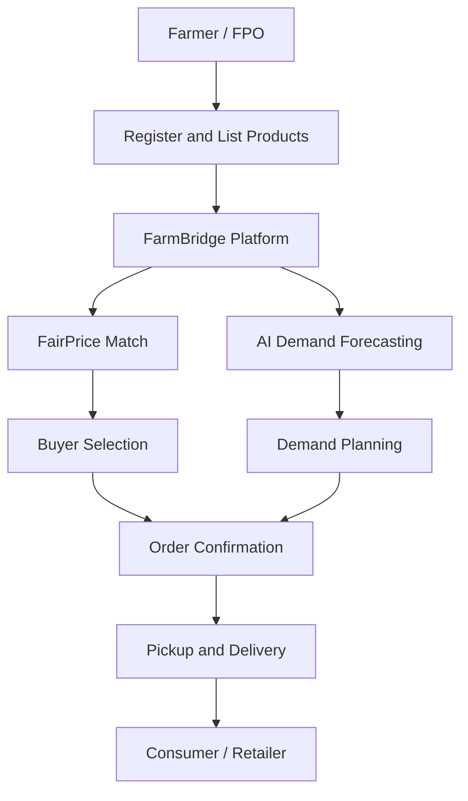

# Smart India Hackathon Workshop
# Date: 24-11-2026
## Reference Number: 26017067
## Name: Thanuja P

## Problem Title
SIH 26033: Multiple intermediaries reduce farmers earnings and increase consumer prices.

## Problem Creater's Organization
Ministry of Consumer Affairs, Food & Public Distribution

## Theme
Agriculture, FoodTech & Rural Development

## Problem Description
Expected Solution: Create a digital marketplace that:

• Connects farmers/FPOs directly with consumers and bulk buyers.
• Provides logistics support.
• Uses AI for demand forecasting and route optimization.

Benefits:

• Better prices for farmers.
• Lower prices for consumers.
• Reduced supply chain inefficiencies.

## Proposed Solution
FarmBridge is a digital agricultural marketplace that connects farmers, Farmer Producer Organizations (FPOs), consumers, retailers, and bulk buyers through a single platform. It enables farmers to list their produce, quantity, quality, location, and expected price, allowing buyers to explore products and place orders directly.

The platform includes a FairPrice Match feature that compares multiple buyer offers and helps farmers make informed selling decisions. A demand forecasting module estimates the demand for agricultural products using previous order data and market trends, helping farmers plan their harvest and reduce wastage. A logistics support system connects farmers and buyers with suitable pickup and delivery options.

**How it addresses the problem:**
- Reduces dependence on unnecessary intermediaries.
- Improves price transparency for farmers and consumers.
- Connects farmers with individual and bulk buyers.
- Helps reduce post-harvest wastage through demand planning.
- Supports efficient transportation and delivery.

**Innovation and uniqueness:**
FarmBridge combines direct selling, buyer-offer comparison, demand forecasting, and logistics support in one platform, creating a more transparent and farmer-friendly marketplace.

## Technical Approach
### Technologies Used
- **Frontend:** HTML, CSS, JavaScript
- **Backend:** Python (Django)
- **Database:** MySQL
- **AI/Analytics:** Python-based demand forecasting
- **Mapping:** Location-based farmer and buyer matching

### Methodology
1. Farmers and buyers register and log in to the platform.
2. Farmers/FPOs upload product details, quantity, location, and expected price.
3. Buyers search for products and compare available prices.
4. FairPrice Match compares buyer offers to help farmers select suitable deals.
5. Demand forecasting estimates future product demand using historical order data.
6. The logistics module helps coordinate pickup, delivery, and route planning.
7. Orders are confirmed and tracked through the platform.

### System Workflow
Farmer → Product Listing → Marketplace → Buyer Search → Offer Comparison → Order Confirmation → Delivery

The system stores product, user, price, and order information in a database and provides a user-friendly interface for farmers and buyers.

## Feasibility and Viability

### Technical Feasibility
The proposed FarmBridge platform can be developed using commonly available web technologies such as HTML, CSS, JavaScript, Python Django, and MySQL. AI-based demand forecasting and location-based logistics can be integrated gradually as the system develops.

### Operational Feasibility
The platform is designed with a simple and user-friendly interface that can be used by farmers, Farmer Producer Organizations (FPOs), consumers, retailers, and bulk buyers. Easy product listing, price comparison, and order tracking will make the process convenient.

### Economic Feasibility
The platform can reduce the need for multiple intermediaries, helping farmers receive better returns and consumers purchase products at reasonable prices. Using open-source technologies can also reduce initial development costs.

### Challenges and Risks
- Limited internet connectivity in rural areas.
- Digital literacy challenges among some farmers.
- Transportation and delivery coordination.
- Maintaining trust, product quality, and transparent pricing.

### Mitigation Strategies
- Provide a simple, mobile-friendly interface.
- Support regional languages in future development.
- Partner with local logistics providers.
- Ensure transparent pricing and secure user information.

## Impact and Benefits

### Impact on Target Audience
FarmBridge will benefit farmers, FPOs, consumers, retailers, and bulk buyers by creating a direct connection between producers and customers. It helps farmers reach a wider market, reduces dependency on intermediaries, and makes agricultural products more accessible to buyers.

### Social Impact
- Empowers farmers to make independent selling decisions.
- Improves communication between farmers and consumers.
- Encourages digital adoption in agriculture.
- Supports rural communities and small-scale farmers.

### Economic Benefits
- Helps farmers improve their earnings.
- Reduces unnecessary intermediary costs.
- Provides competitive and transparent pricing for consumers.
- Creates opportunities for local agricultural businesses.

### Environmental Benefits
- Helps reduce food wastage through demand forecasting.
- Supports efficient transportation and route planning.
- Encourages a more sustainable agricultural supply chain.

## Research and References

### 1. National Agriculture Market (e-NAM)
Website: https://enam.gov.in/

Research: e-NAM is an online agricultural trading platform that connects markets across India. It promotes transparent trading, better price discovery, and wider market access for farmers.

Relevance to FarmBridge: It serves as a reference for digital agricultural marketplaces and farmer-to-buyer connectivity.

### 2. Ministry of Agriculture and Farmers Welfare – Government of India
Website: https://www.pib.gov.in/

Research: Government reports on e-NAM highlight digital agricultural marketing, transparent pricing, farmer participation, and improved market access.

Relevance to FarmBridge: Supports the need for digital solutions that help farmers connect with buyers and make informed selling decisions.

### 3. Economic Survey of India
Website: https://www.indiabudget.gov.in/economicsurvey/

Research: The Economic Survey discusses agricultural marketing, digital agriculture initiatives, Farmer Producer Organizations (FPOs), and technology-driven development.

Relevance to FarmBridge: Provides background for improving agricultural supply chains through digital technology and better market connectivity.
