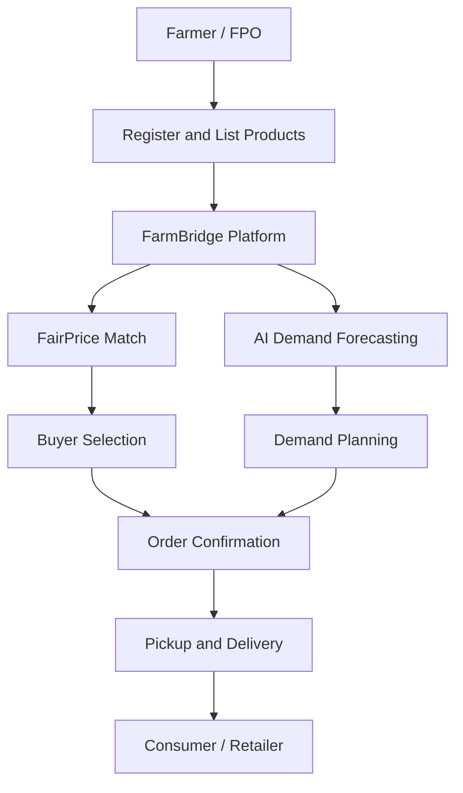

# Smart India Hackathon Workshop
# Date: 24-11-2026
## Reference Number: 26017067
## Name: Thanuja P

## Problem Title
SIH 26033: Multiple intermediaries reduce farmers earnings and increase consumer prices.

## Problem Creater's Organization
Ministry of Consumer Affairs, Food & Public Distribution

## Theme
Agriculture, FoodTech & Rural Development

## Problem Description
Expected Solution: Create a digital marketplace that:

• Connects farmers/FPOs directly with consumers and bulk buyers.
• Provides logistics support.
• Uses AI for demand forecasting and route optimization.

Benefits:

• Better prices for farmers.
• Lower prices for consumers.
• Reduced supply chain inefficiencies.

## Proposed Solution
FarmBridge is a digital agricultural marketplace that connects farmers, Farmer Producer Organizations (FPOs), consumers, retailers, and bulk buyers through a single platform. It enables farmers to list their produce, quantity, quality, location, and expected price, allowing buyers to explore products and place orders directly.

The platform includes a FairPrice Match feature that compares multiple buyer offers and helps farmers make informed selling decisions. A demand forecasting module estimates the demand for agricultural products using previous order data and market trends, helping farmers plan their harvest and reduce wastage. A logistics support system connects farmers and buyers with suitable pickup and delivery options.

**How it addresses the problem:**
- Reduces dependence on unnecessary intermediaries.
- Improves price transparency for farmers and consumers.
- Connects farmers with individual and bulk buyers.
- Helps reduce post-harvest wastage through demand planning.
- Supports efficient transportation and delivery.

**Innovation and uniqueness:**
FarmBridge combines direct selling, buyer-offer comparison, demand forecasting, and logistics support in one platform, creating a more transparent and farmer-friendly marketplace.

## Technical Approach
### Technologies Used
- **Frontend:** HTML, CSS, JavaScript
- **Backend:** Python (Django)
- **Database:** MySQL
- **AI/Analytics:** Python-based demand forecasting
- **Mapping:** Location-based farmer and buyer matching

### Methodology
1. Farmers and buyers register and log in to the platform.
2. Farmers/FPOs upload product details, quantity, location, and expected price.
3. Buyers search for products and compare available prices.
4. FairPrice Match compares buyer offers to help farmers select suitable deals.
5. Demand forecasting estimates future product demand using historical order data.
6. The logistics module helps coordinate pickup, delivery, and route planning.
7. Orders are confirmed and tracked through the platform.

### System Workflow
Farmer → Product Listing → Marketplace → Buyer Search → Offer Comparison → Order Confirmation → Delivery

The system stores product, user, price, and order information in a database and provides a user-friendly interface for farmers and buyers.

## Feasibility and Viability
Remove These Lines
1. Analysis of the feasibility of the idea
2. Potential challenges and risks
3. Strategies for overcoming these challenges

## Impact and Benefits
Remove These Lines
1. Potential impact on the target audience
2. Benefits of the solution (social, economic, environmental, etc.)

## Research and References
Remove These Lines
1. Details / Links of the reference and research work
